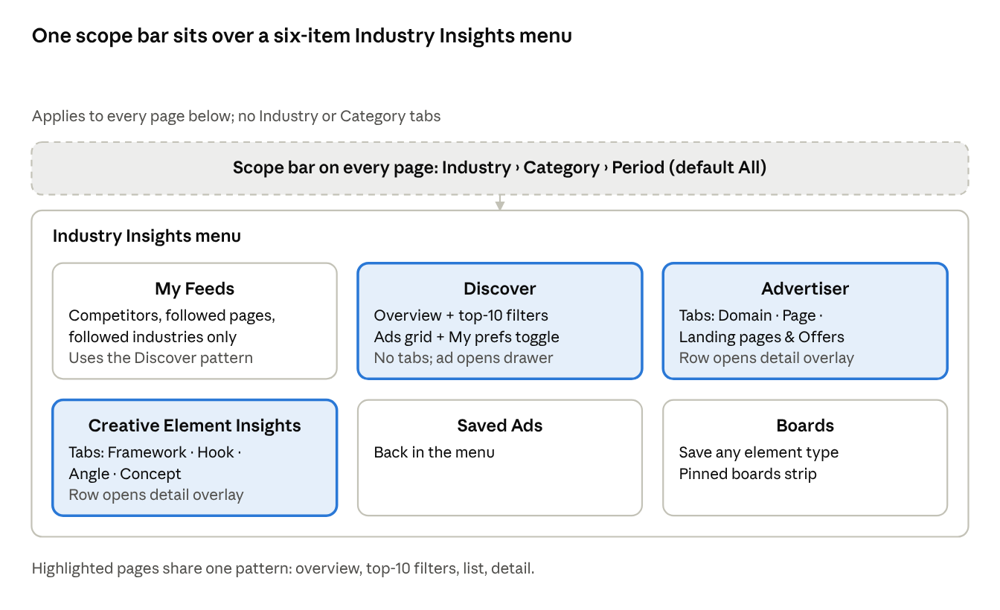
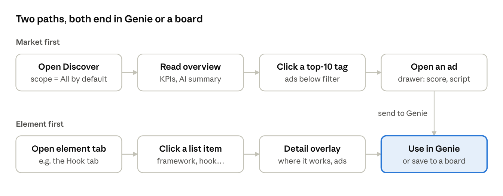

# Industry Insights Update — PRD & IA

Oct 10, 2026 · @Rahul Saini

## Summary

Industry Insights moves from an ad library to an insight tool. Users first see what is working in their market, then go to the ads behind it. Today they land on a grid of ads and have to guess what to filter.

- **What changes:** a new menu (My Feeds, Discover, Advertiser, Creative Element Insights, Saved Ads, Boards), one scope bar on every page, and one page pattern everywhere: overview, top-10 filters, list, detail.
- **Where the data comes from:** AdVault, our internal tool, is the reference. We take only what helps a paying customer and rebuild it our way.
- **What's new for users:**
  - AI analysis on every ad: hook, angle, framework, concept, script.
  - Market overviews with counts on every filter.
  - Advertiser and creative-element insights.
  - Transparent AI scoring.
  - A path from insight to Genie.
- **Where it's built:** the FabAds prototype, for demo. Plan limits are out of scope.
- **Companion doc:** page-by-page specs (overview, list, sorting, detail sections) for each page.

## Problem and goals

Showing ads directly doesn't help, because users don't know what to filter or look for. They scroll a grid and leave without knowing what is working or what to do next.

**Problems today**

- **The feed is an ad library with no aggregation.** It answers "which ads exist", never "what is working".
- **Filters come first.** Users must already know what they want before they see anything useful.
- **Taxonomy and tags are generic or fake** (e.g. SaaS, #ChicVibes). They don't match the industries our customers run.
- **"Analysed" hides data behind a step.** Most of an ad's value sits locked behind it.
- **The reference tool has the data but buries it.** AdVault shows the right data in a long, repetitive scroll, its numbers disagree between screens, and every click takes the user out of the page.

**Goals**

1. **Show what is working before asking users to filter.** Every page opens on an overview of the current scope.
2. **Make every number a way in.** Counts on every filter, menu and tag; clicking a tag filters the list.
3. **Explain the market through advertisers and creative elements.** Who is winning, and which hooks, angles, frameworks and concepts are behind it.
4. **Earn trust in AI data.** Show the AI score's reasons and examples, "based on X ads" notes, and honest empty states.
5. **Turn insight into action.** Save anything to a board, and use a framework, hook or angle in Genie.

## Users and product principles

The primary users are paying customers running ads in verticals like Lead Gen, VSL and Search Arb. Everything they see must be clean, explainable and ours.

- **Only our data.** Spy-tool or source names (AdSpy, ForePlay, Meta Ad Library etc.) are never shown.
- **Overview first, filters second.** Defaults are "All industries" and "All categories"; filters are surfaced as clickable elements, not a form to fill.
- **Every count is clickable and honest.** Counts follow the current scope, and a 0 option is disabled, not hidden.
- **AI is transparent.** Show the AI score's breakdown with reasons and examples, the "based on X analysed ads" note, and that AI suggestions never equate most common with best.
- **Missing data never breaks the layout.** A section without data is disabled with a tooltip explaining why.
- **Unreliable data stays secondary.** Likes, comments and shares are missing on about 80% of ads, so they get no filters and no sorting and appear only inside detail views.
- **Pick, don't copy.** AdVault is the reference; we keep what is useful and rebuild it in FabAds patterns.

## Scope

This update covers the Industry Insights module in the FabAds prototype, for demo. It reuses existing prototype patterns wherever they already work.

**In scope**

- New menu and IA (section below)
- Scope bar on every page
- Overview + top-10 filters + list + detail pattern on Discover, Advertiser and Creative Element Insights
- AI analysis data on every ad (no analysed / not analysed toggle)
- Element and advertiser detail overlays; updated ad detail drawer
- Real industry and category taxonomy and real trending tags from AdVault
- Save to board and download for every element type
- AI summary, gap suggestions and Genie handoff

**Out of scope**

- Plan limits and upsell
- A separate Competitors page (for now)
- Performance comparison reports between the user's ads and the market
- Industry or Category tabs (the scope bar replaces them)

**Keep from the prototype**

- URL-backed state (every filter, drawer and modal survives refresh and sharing)
- Compact header on scroll
- Follow brand
- Pinned boards
- Genie handoff

## Information architecture

Six menu items under one scope bar. Domains and Competitors leave the sub-nav: domains move into Advertiser, and competitor data shows in My Feeds.

Removed from the current prototype: the Domains and Competitors sub-nav items, the My preference nav item (now a toggle in Discover), and Industry/Category tabs.

## Shared page pattern and click/filter rules

Discover, Advertiser and Creative Element Insights all use one structure, so users learn it once. Each page reads top to bottom.

1. **Scope bar:** Industry › Category › Period, default All. Discover also has a "My preferences only" toggle.
2. **Tabs:** only on Advertiser (Domain, Page, Landing pages & Offers) and Creative Element Insights (Framework, Hook, Angle, Concept). Discover has no tabs.
3. **Overview:** KPIs, AI summary, launch frequency, and Rising + Scaling in the expanded state, with a "based on X analysed ads" note. Collapsible where data is light.
4. **Top-10 filters:** groups of tags with counts. Click to select; multi-select allowed. "View more" opens a modal with the full scrollable list, where items can also be selected.
5. **Selected chips + total:** chips with Clear all, and the total results below.
6. **List:** an ads grid on Discover; an element or advertiser list everywhere else. Sorting sits on the list.

| What is clicked | Where | Result |
| --- | --- | --- |
| Overview tag | Discover, Advertiser, Creative Element Insights | Applies a filter. Other tags keep their counts; only the total below changes |
| Multiple tags | Same | Total shows the combined set: ads matching any selected tag, each ad counted once |
| "View more" | Any top-10 group | Modal with the full list, selectable |
| An ad | Anywhere | Ad detail drawer |
| A list item (domain, page, LP/offer, framework, hook, angle, concept) | Advertiser, Creative Element Insights | Detail overlay, like today's competitor detail; URL-backed, with a back chip for nested drill-down |
| Save / Download | Every ad and element | Save to board (any element type) or download |
| A section with no data | Anywhere | Disabled, with a tooltip explaining why |

## Key user flows

Both paths start at the default scope (All) and end in an action the user can reuse.

- **Market first:** user starts broad in Discover, narrows with top-10 tags, then opens one ad in the drawer to read its score and script.
- **Element first:** user starts from a creative element (Framework, Hook, Angle or Concept), opens its detail overlay, and takes it straight to Genie or a board.

## Data rules and definitions

One definition per term, used the same way on every screen. The reference tool used four meanings for "winner" and lost user trust doing it.

| Term | Definition | Note for design |
| --- | --- | --- |
| Winning ad | Running days + number of clones/similar ads + status | Never based on likes. Ads that also do outstandingly on extra data (e.g. engagement) get an additional highlight |
| Active ad | Seen live recently (AdVault uses the last 14 days) | Label it so users know it is "seen live", not a platform status |
| New tag | Items added since the user's last visit | 5 new since a visit 1 min ago = 5 tagged. Nothing new in 2 days = no tag |
| Days live | Start date to last seen | Show "Start date unknown" instead of inventing a number |
| Clones / similar ads | Copies of the same creative seen across advertisers | Strongest winner signal; shown on every ad card |
| AI score | 1–100 with tier (Elite ≥80, Strong ≥60, Average ≥40, Weak) | Always with a breakdown: reason and example for each part |
| Engagement (likes, comments, shares) | Reported only for about 20% of ads | No filters, no sorting. Inside detail only, "Not reported" when missing |
| Trend / rising % | Change vs previous period | No minimum base. Bars carry a unit label (e.g. "ads per day") and a tooltip with date + count |
| Analysis data | Hook, angle, framework, framework element, concept, script, transcript | Shown by default on all ads. Partial data → disabled section + tooltip |

**Taxonomy and naming**

- **Industries:** the real 7–8 industries from AdVault (e.g. Lead Gen, VSL, Search Arb).
- **Categories:** the full A–Z list from AdVault, available in every industry; data filters by scope. Defaults are "All industries" and "All categories".
- **Concept:** AdVault's "Creative format" data, renamed because that is what it actually is.
- **Brand = Page.** "Follow" applies to pages and feeds My Feeds.
- **Competitor:** domains and pages the user marks; their data appears in My Feeds.
- **Trending tags:** real AdVault topic and angle data replaces the placeholder hashtags.
- **Sorting:** never by likes, comments or shares. The prototype's "Most active" and "Most popular" become "Longest running" and "Most cloned".

## Prototype surfaces that change

The new IA touches more than the Industry Insights pages. These are the places found in the FabAds prototype that need updating so labels and flows stay consistent.

| Surface | Change |
| --- | --- |
| Sidebar sub-nav | New items: My Feeds, Discover, Advertiser, Creative Element Insights, Saved Ads, Boards. Domains and Competitors items removed |
| My Feed page | Identity row, followed brands popover and settings modal align with "Follow page" and competitors; collapsible overview added |
| Discover page | "Trending / By Industry / By Platform" replaced by scope bar, overview, top-10 filters and ads grid |
| Competitor detail overlay | Becomes the shared detail template for Domain and Page |
| Domains page | Moves into Advertiser › Domain |
| Ad card and ad detail drawer | Analysis chips, New/Winner badges, AI score breakdown, merged creative breakdown, LP / offer / funnel |
| Search popover | Scopes (today: My feeds / Discovery / Competitors / Boards) follow the new menu |
| Dashboard tiles | Labels such as "Brands followed", "Categories tracked", "Competitors", "Pages tracked" match the new naming |
| Onboarding quick setup | Industry and page follows feed My Feeds preferences |
| Genie Industry Insights picker | Picks frameworks, hooks, angles and concepts as well as ads |
| Reports cross-sell card | Copy updated to the new module |
| Dummy data | Real industries, A–Z categories, real trending tags and analysis fields replace the generic placeholders |

## Open items to confirm

- [x] My Feeds uses the Discover pattern (collapsible overview + top-10 filters + ads grid), limited to competitors, followed pages and followed industries
- [x] Combined total across different tag groups (e.g. a framework tag + a hook tag) also shows ads matching any selected tag
- [x] Creative Element Insights list also shows live ads, advertiser count, longest run and total clones (from AdVault)
- [x] Element and advertiser lists have no Newest, Oldest, Most cloned or AI score sort (removed)
- [x] Discover sketch wireframe: goes to the build session. Before Discover is built, the orchestrator compares it with this pattern and brings only the differences back for a decision

All page-level decisions are in the Page Specs doc › Open questions (all decided).
