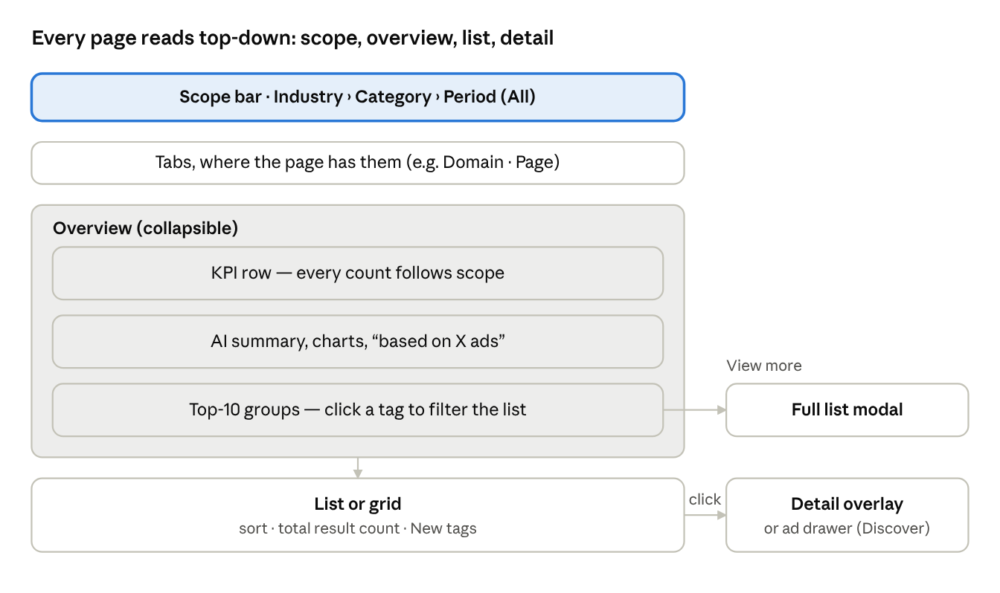

# Industry Insights Update — Page Specs

Oct 10, 2026 · @Rahul Saini

## How to read this doc

This is the page-by-page companion to [Industry Insights Update — PRD & IA](01-prd-and-ia.md). The PRD says what and why. This doc says what sits on each screen, in what order, and how it behaves.

- **Source of truth:** the FabAds prototype. AdVault is only a reference; we take what's useful and rebuild it our way.
- **Goal:** a working demo on dummy data, so plan limits are ignored everywhere.
- **Data shown:** only our own data. Spy-tool or source names (AdSpy, ForePlay etc.) never appear anywhere in the UI.
- **Out of scope for this round:** "against what" comparisons and recommendation types per page. Only overview KPIs, top-10 groups, list columns, sorting and detail sections are specced here.

**Rules that hold on every page**

- **Scope bar on top:** Industry › Category › Period, default All. Every number, list and chart on the page follows it. No Industry or Category tabs exist anywhere.
- **Counts everywhere:** every filter, menu and sub-menu item shows its count for the current scope. Options with 0 stay visible but disabled.
- **Top-10 filters add up:** picking a tag doesn't change the counts on other tags. Only the total result count below changes, and it shows the combined total of everything picked.
- **Winner** = running days + number of clones/similar ads + status. Never likes.
- **Engagement (likes, comments, shares) is secondary:** \~80% of ads don't have it. No outside filter, no sort, shown inside a grouped block with "Not reported" when missing.
- **Analysis data is on by default:** hook, angle, framework etc. show for every ad. No "analysed only" toggle.
- **"Based on X ads" note:** every overview, summary and analysis block says how many ads it's built on.
- **Most common ≠ best:** AI summaries and suggestions never present the most used item as the best one.
- **Save and download:** available on every element type (ads, hooks, frameworks, angles, concepts, landing pages), not just ads.
- **Keep from the prototype:** URL-backed state, compact header on scroll, Follow brand, pinned boards, Genie handoff.

## Shared page pattern

Discover, Advertiser and Creative Element Insights all use one pattern. Learn one page, and the user knows all three.

1. **Scope bar:** sets Industry › Category › Period for everything below. Default is All.
2. **Tabs:** only where the page has sub-types (Advertiser: Domain / Page / LP & Offers; Creative Element Insights: Framework / Hook / Angle / Concept). Discover has no tabs.
3. **Overview:** collapsible. Small top row where data is light; can grow into a full tab where data is heavy.
   - KPI row for the current scope.
   - AI summary + charts (launch frequency, rising + scaling) with the "based on X ads" note.
   - Top-10 groups. Each tag shows its count. Click = multi-select filter on the list below.
   - **View more** on a group opens a modal with that group's full scrollable list.
4. **List or grid:** sort control, total result count (combined total of picked tags), New tags.
5. **Click a row or card:** opens the detail overlay (large overlay, like today's competitor detail). On Discover, an ad click opens the ad drawer instead.

Why this order: the core problem is that users don't know what to filter for. Numbers and top-10 elements come first so they see what's working before they hit a wall of ads.

## Discover

The market view. User lands here to see what's running in the picked scope, then narrows down through tags instead of guessing filters.

**Top of page**

- Scope bar (shared).
- **"My preferences only" toggle:** limits everything on the page to the user's preferences. **Off by default**, because Discover is the market view. My preference is no longer a nav item; this toggle replaces it.
- No tabs.

**Overview — KPI row**

| KPI | What it shows |
| --- | --- |
| Total ads | All ads in the current scope |
| Active ads | Ads still running |
| Winning ads | Ads that pass the Winner rule (running days + clones + status) |
| Advertisers | Advertisers with ads in scope |
| New ads | Ads added since the user's last visit |
| Avg days live | Average running days across ads in scope |
| Landing pages & offers | Landing pages and offers used by ads in scope |

Analysed coverage was offered as a KPI and not picked.

**Overview — widgets**

- **AI summary** of the scope, with the "based on X ads" note.
- **Launch frequency chart:** how many ads launch over time. Bars carry a unit label and a tooltip, so the user knows what a bar means (an AdVault gap we fix).
- **Rising + Scaling:** one combined section, shown only when the overview is expanded.
- **Trending tags:** the prototype's placeholder hashtags are replaced with real reference data.

**Overview — top-10 groups**

Each group shows its top 10 with counts. Click = filter the ads below. **View more** opens the full list in a modal.

1. Hook style
2. Angle
3. Framework
4. Framework element
5. Concept
6. Keyword / topic
7. CTA
8. Advertiser / domain
9. Landing pages
10. Country
11. Category — only when no category is picked in the scope bar

**Ad grid — card**

- Industry + Category chips.
- New tag + Winner badge.
- Days live + status + clones.
- AI score + analysis chips (hook, angle, framework etc.).
- Save and download, like every element.

**Sort**

| Option | Note |
| --- | --- |
| Newest |  |
| Oldest |  |
| Longest running | Absorbs the prototype's "Most active" |
| Most cloned | Absorbs the prototype's "Most popular" |
| AI score |  |

No sort by likes, comments or shares.

**Click behaviour**

- Click a tag → filters the grid; total count updates, other tag counts stay.
- Click an ad → ad drawer (see Ad drawer).
- Click an element on a card (hook, framework, industry…) → that element's detail overlay.

## My Feeds

The personal view. Same market data, but only from sources the user chose.

**What feeds it (confirmed)**

- Pages and domains the user marked as competitors (from the Advertiser list).
- Pages the user follows. Brand = Page, so Follow brand lands here too.
- Industries the user follows.
- It already follows the user's preferences, so it needs no "My preferences only" toggle.
- No separate Competitors page or sub-item for now. Competitor data shows up here.

**Overview (confirmed)**

- Same overview rule as other pages: small collapsible top row when data is light, a full tab when data is heavy.

**Page layout (confirmed)**

- Uses the Discover pattern as-is: scope bar → collapsible overview (KPIs, AI summary, launch frequency, top-10 groups) → ad grid → ad drawer.
- Same KPIs, top-10 groups, ad card and sort as Discover. Only the data source is narrower.
- Why: one learned pattern, and the demo needs no new components.

## Advertiser

Who is running ads in the scope, who is scaling, and how they do it. Replaces today's Domains and Competitors pages.

**Tabs:** Domain · Page · LP & Offers. Brand = Page. Landing pages and offers are one tab.

**Domain and Page tabs — KPI row**

- Total advertisers
- Active advertisers
- New advertisers (since last visit)
- Scaling advertisers
- Rising advertisers

**Domain and Page tabs — top-10 groups**

Hook, Angle, Framework, Concept, CTA, Country, and Category (Category only when no category is picked in the scope bar). Click = filter the list; View more = modal.

**Domain and Page tabs — list columns**

| Column | What it shows |
| --- | --- |
| Name | Domain or page |
| Total + Active ads | Both numbers in one cell |
| Winning ads + Longest run | Winner count and the longest running ad's days |
| Launch trend | Small trend of new ads over time (unit label + tooltip) |
| Top framework / hook / concept | The advertiser's most used of each |
| Industry + Category | Where the advertiser runs |
| Landing pages / offers | Count |
| Actions | Mark as competitor · Follow |

- **Mark as competitor:** sends this domain or page into My Feeds.
- **Follow:** for brands (pages). Followed brands go into My preferences and drive My Feeds.
- Tracked competitors and market advertisers show the same data. Marking changes where it shows, not what it shows.

**Domain and Page tabs — sort**

- Most ads
- Most active / scaling
- Most winners
- Longest run

No Newest, Oldest, Most cloned or AI score sort for advertisers.

**Reference:** AdVault's Creative Report lists advertisers on top and shows the picked advertiser's overview below. We use its data for the Advertiser detail overlay.

**LP & Offers tab**

- Same shared pattern: scope bar → overview → list → row click opens the LP & Offers detail overlay.
- **One row = one landing page.** Its offer shows in a column, so one offer used by many landers appears through the Offer domain filter.

*KPI row*

- Total landing pages + total offers
- Active landing pages (ads still running) + New landing pages (since last visit)
- Rising landing pages + average ads per landing page

*Top-10 groups*

- Funnel type (Quiz funnel, Advertorial pre-sell, Direct VSL, Lead form, Product page)
- Offer domain
- Hook, Framework, Concept (the creatives that send traffic to the page)
- Country
- CTA

*List columns*

| Column | What it shows |
| --- | --- |
| Page | Screenshot thumbnail, domain and page title |
| Offer | Offer domain the page sends to ("Not traced" when missing) |
| Funnel type | One of the five funnel types |
| Ads | Total + active ads landing here |
| Advertisers | How many advertisers use this page |
| Winners | Winning ads landing here |

*Sort*

- Most ads
- Most active
- Most advertisers
- Longest running
- Fastest rising

## Creative Element Insights

The element-first view. User starts from a creative building block and sees where it works, then takes it to Genie.

**Tabs:** Framework · Hook · Angle · Concept. One tab per element. "Concept" is what AdVault wrongly titles "Creative format". Formats are not a separate tab.

**Overview — KPI row (every tab)**

- Total items + ads analysed (e.g. 13 frameworks across N ads)
- Top item + its share
- Fastest rising item
- Video vs image split
- Plus everything picked for the Discover overview: Total ads, Active ads, Winning ads, Advertisers, New ads, Avg days live, Landing pages & offers, AI summary, launch frequency, Rising + Scaling

**Overview — top-10 filters**

- Top-10 groups sit on top; click = filter the list below; View more = modal.
- Groups per tab = Discover's groups minus the tab's own element (the Hook tab doesn't filter by hook, the Framework tab doesn't filter by framework, and so on).

**List columns (every tab)**

| Column | What it shows |
| --- | --- |
| Item | Framework, hook, angle or concept name |
| Ads using it + share % | Count and share of ads in scope |
| Winning ads + avg days live | How well ads using it hold up |
| Trend | Rising or falling use (unit label + tooltip) |
| Example + top advertisers | One example ad and who uses it most |
| From AdVault | Live ads, advertisers count, longest run, clones |

**Sort**

- Most used
- Most winners
- Fastest rising
- Longest running

No Newest, Oldest, Most cloned or AI score sort for elements.

**Click behaviour**

- Click a top-10 tag → filters the list.
- Click a list item → Element detail overlay.
- Save to board and download on every item, so a user can keep a hook or framework, not only an ad.

## Detail overlays

All three open as a large overlay, like today's competitor detail. Each follows the scope bar. The template is dynamic: a section with no data for that item type is left out, and a section with missing data for one item shows disabled with a tooltip.

### Advertiser detail (Domain or Page)

1. **Header + AI summary + KPIs:** name, Mark as competitor / Follow, AI strategy summary ("based on X ads"), KPIs.
2. **Launch activity:** new ads over time (unit label + tooltip).
3. **How they hook + takeaways:** hooks, angles, frameworks, concepts, CTA mix, keywords.
4. **Winning and longest running ads + landing pages.**

Today's competitor detail already has most of this (AI Strategy Summary, KPIs, Ad Launch Activity, Angle Mix, Proven Winners, Top Hooks & Keywords, CTA Mix, Landing Pages). The change is one view instead of Analysis / Ads tabs, plus frameworks and concepts.

### Element detail (Framework, Hook, Angle, Concept)

1. **Header + AI summary + KPIs.**
2. **Where it works:** categories, industries, advertisers.
3. **Works well with:** elements that show up together with it in the same ads.
4. **Top ads + examples:** with **Use in Genie** and **Save**.

### LP & Offers detail

1. **Page capture:** screenshot, final URL, HTTP status, word count, searchable page text.
2. **Funnel:** type, redirect path, offer page.
3. **Ads + advertisers using it.**
4. **Creative mix:** which hooks, angles, frameworks, concepts lead to this page.

## Ad drawer

Opens on any ad click (Discover, My Feeds, overlays, Saved Ads, Boards). Keeps everything in today's ad detail drawer and adds the analysis in one view. Video Sage tabs are not reused as-is; script, storyboard and framework data are merged.

**Kept from today's drawer**

- **Creative:** the ad's video or image, with copy.
- **Meta row:** page name, last synced, page ID (copy), transparency regions, status / active since.
- **Actions:** Create Variations, Add to competitor, Save to Board (with board count), Copy link, More.
- **Stats grid:** Category, Spend till now, Ad creation, Active duration, CTA button, Est. audience size, Impressions, Total reach, BR reach, EU reach.
- **Ad keywords (AI generated) + Platforms.**
- **Targeted demographics** (age, gender, %) and **Location** (location, type, include / exclude).
- **Domains + Language.**
- **Similar ads.**

**Removed from today's drawer**

- "Analysed / Not analysed" badge.
- "Analyse again" and "Add to analysis queue" buttons.
- Why: analysis data shows by default on every ad. Partial data is handled by disabled sections with tooltips, not by a status badge.

**Added**

1. **Industry + Category chips, New tag, Winner badge** — same as the card.
2. **Metrics:** days live, clones, status; engagement (likes, comments, shares) grouped inside, "Not reported" when missing.
3. **AI score breakdown:** total + tier (Elite ≥ 80, Strong ≥ 60, Average ≥ 40), the parts it's built from, and a short explanation with examples so users trust it.
4. **Creative breakdown (one merged view):** framework, hook, angle, concept; script + storyboard + timeline together; transcript. Each element is clickable → its detail overlay.
5. **Landing page + offer + funnel:** page capture, offer details, funnel path. Click → LP & Offers detail overlay.
6. **Use in Genie** from the script or any element; Save and download on each element.

## Saved Ads and Boards

Both stay in the menu as they are in the prototype today. What changes is what can be saved.

- **Save from anywhere:** ad cards, the ad drawer, every list row and every detail overlay.
- **Any element type goes to a board:** ads, hooks, frameworks, angles, concepts, landing pages. A user can build a board of winning hooks, not only ads.
- **Saved Ads lists ads only.** Saved elements live in boards.
- **Download** sits next to Save on every element.
- **Pinned boards** stay, as in the prototype.
- **Opening a saved item** opens the same drawer or overlay it was saved from.

## States

Some ads have full analysis, some partial, most have no engagement. The design must not break in any of these.

**Missing data (confirmed)**

- A section with no data for this item shows **disabled with a tooltip** saying why. It doesn't collapse or vanish, so layouts stay stable.
- Engagement sits in its own inside group and shows **"Not reported"** when missing.
- Filter and menu options with a 0 count stay visible and disabled.
- Every summary says how many ads it's built on, so partial data is visible, not hidden.
- Known gap in dummy data: some ads have no country, so Country counts won't add up to Total ads.

**New since last visit (confirmed)**

- "New" marks items added since the user's last visit.
- Example: 5 ads added since a visit 1 minute ago → those 5 get the tag. Nothing added in 2 days → no tag anywhere.
- Applies to ads, and to the New ads / New advertisers KPIs.

**Trend numbers (confirmed)**

- Trend % shows with no minimum base.
- Every bar or trend chart has a unit label and a tooltip.

**Empty and loading (confirmed)**

- **No results after filtering:** say so and offer one click to clear the picked tags.
- **My Feeds with nothing followed or marked:** explain what feeds it and link to Advertiser to mark competitors or follow pages.
- **Loading:** reuse the prototype's existing loading pattern; no new component.

## Open questions

All decided by Maalik on Oct 10, 2026. The sections above already reflect these answers.

| # | Question | Decision |
| --- | --- | --- |
| 1 | Does My Feeds use the Discover layout as-is? | Yes, same KPIs, groups, card and sort |
| 2 | Tags from two different groups: add up or narrow down? | Add up (union), same as within a group |
| 3 | Discover's "My preferences only" toggle default? | Off |
| 4 | Top-10 groups on the Advertiser tabs? | Hook, Angle, Framework, Concept, CTA, Country, Category |
| 5 | LP & Offers tab: KPIs, groups, columns, sort? | Decided — see Advertiser › LP & Offers tab |
| 6 | Top-10 groups on each Creative Element tab? | Discover's groups minus the tab's own element |
| 7 | Extra AdVault columns on Creative Element lists? | Keep live ads, advertisers, longest run, clones |
| 8 | Newest, Oldest, Most cloned, AI score sorts for advertisers and elements? | Removed |
| 9 | Element overlay "Where it works" for frameworks too? | Yes, for all four. Seeing where a framework ran is useful |
| 10 | Analysed badge and Analyse buttons in the drawer? | Removed |
| 11 | Highlight for Winner ads that also do great on likes/comments? | A small extra mark on the Winner badge, with a tooltip |
| 12 | Saved Ads scope; what a saved item opens | Ads only (elements live in boards); opens the same drawer or overlay |
| 13 | Empty and loading states | Approved as proposed |
| 14 | Discover sketch wireframe | Goes to the build session; orchestrator compares it with the Discover spec and asks only about differences |
